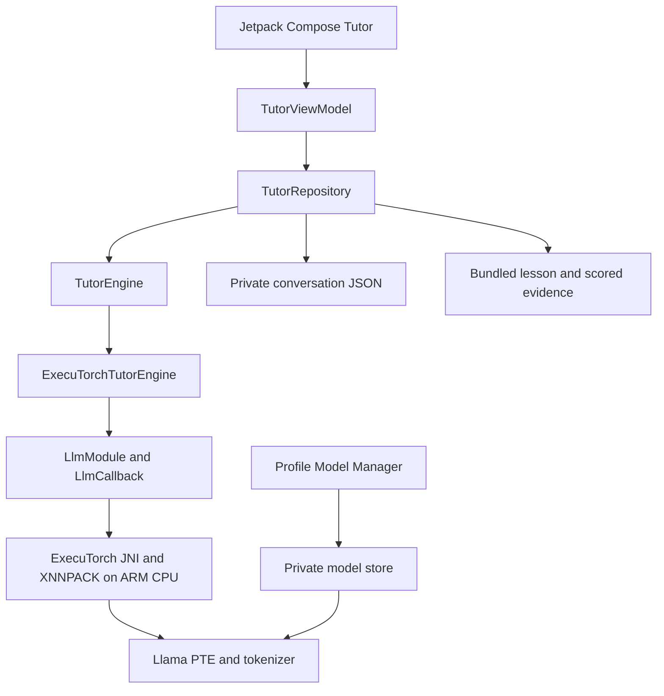
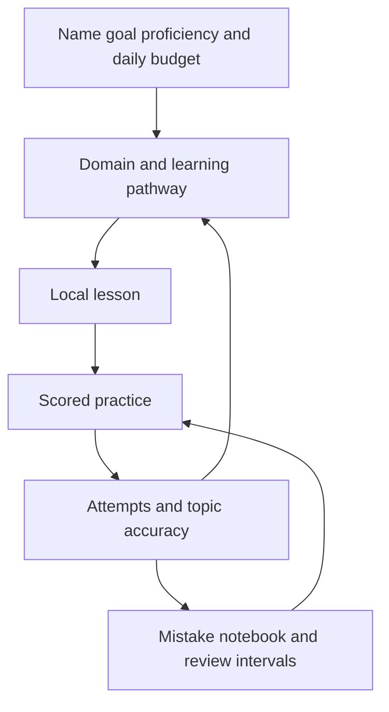

# Aurora architecture

The personal learning platform adds `PlatformRepository` and a Room database scoped by local profile ID. The topic workspace holds saved lessons, drafts, attempts, study time, notes and revision evidence. `LearningPlatform` coordinates profile switching and routes generation through the existing `LocalTutor`, which serializes access to the device model. See the [data model](DATA_MODEL.md), [learning engine](LEARNING_ENGINE.md) and [quiz engine](QUIZ_ENGINE.md).

The recovered branch has a single Android app module. Compose views observe shared state, and the existing persistence coordinator serializes writes for each key. Model binaries live under the application’s no-backup directory. A mutex serializes model import, generation, unloading and deletion. The repository persists completed responses and keeps active streaming output transient. When the module is missing, the Tutor surfaces the import requirement.
