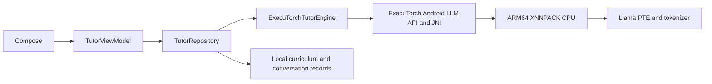
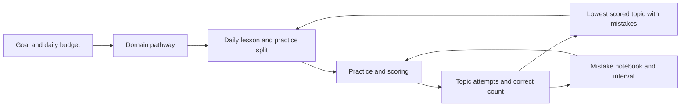

# ADAPT-AI · Aurora
## ARM Bharat AI-SoC Challenge 2026–27 · Problem Statement 4

### Executive summary

Aurora connects a local learning roadmap, lesson content, deterministic assessment and review to a five-mode Android tutor. The tutor uses the pinned ExecuTorch Android LLM API and a separately installed Llama bundle. The current delivery has host-verified model artifacts. Physical-device acceptance, including native generation, remains open.

### Problem statement and analysis

PS4 asks for an on-device personalised learning assistant on ARM Android. A learner needs a path from an initial goal and skill estimate to practice evidence, revised recommendations and a review routine. Lightweight local storage and an independently scored learning engine allow that flow to continue wherever connectivity is unreliable.

### Objectives and user workflow

Choose a domain and goal, set a daily time budget, and record the learner’s initial proficiency. Open Journey to find the active lesson and the day’s lesson/practice split. Work through a local lesson and submit practice answers. Return to Journey to review scored concepts or visit the mistake notebook. Use Tutor for explanation, guided questions, debugging, drills or review after importing a verified model.

### System architecture and Android design

Kotlin and Jetpack Compose provide Home, Journey, Tutor, Practice and Profile. Supporting views cover learner onboarding, domain selection, local lessons and model management. Orbiting particles and intersecting translucent ribbons produce the Canvas orb. The draw phase receives frame updates while its lifecycle is started. System animator settings reduce motion. Home accepts text and can transcribe through Android’s on-device speech recognizer. Tutor can read a response aloud with a locally available, non-network voice.

### Model identity, source and licence

The target is Meta’s Llama 3.2 1B Instruct. The pinned candidate was published by `executorch-community` at revision `911221e0f49d3354cbd4697a9c09feee25cadec7`. Its PTE is 1,135,951,488 bytes with SHA-256 `8715cdba9e91f6bede00cc5f2d6b12397b95225da5630c4972a8da03001cda3b`. The tokenizer is 2,183,982 bytes with SHA-256 `82e9d31979e92ab929cd544440f129d9ecd797b69e327f80f17e1c50d5551b55`. The tokenizer’s 128,000 merge ranks also passed local structural validation. See [model setup](MODEL_SETUP.md) and [licence notices](THIRD_PARTY_NOTICES.md).

### Export, quantisation and ARM runtime

The publisher candidate is SpinQuant INT4 EO8 with XNNPACK and a 2,048-token model context. Its recipe references a 0.6 release candidate. The app uses the released ExecuTorch 1.0.0 AAR and a 1,024-token maximum total generation sequence. A pinned 1.0.0 export tool for authorised checkpoint inputs also supports 8da4w or INT8 using the XNNPACK backend. The deployment target is ARM64 CPU. Acceleration and measured performance require validating the actual execution path on the phone.

The Model Manager stages imports in private storage, verifies the manifest and both checksums, attempts native loading, then switches an atomic pointer to the newly checked model. Loading, generation, replacement and unloading share serialized native ownership. Callbacks stream text and record elapsed/first-token timing. Stopping a response cancels collection and requests native stop. A watchdog requests stop after two minutes. Native context is reset per request, and bounded recent turns are included in the prompt.

### Personalisation, skill gaps and study planning

Topic accuracy is correct attempts divided by valid attempts. A learner is unassessed with zero attempts. Practice validates choices against the curated correct option, logs each valid submission once per question in a session, and updates topic accuracy and the mistake notebook. An incorrect answer flags the problem for a one-day review interval. A correct reattempt resolves it and records a longer interval. Journey shows the weakest scored topic and the observed evidence behind the review cue. The day plan allocates the active lesson up to the daily budget and gives the remaining minutes to practice.

### Local retrieval and Tutor modes

The current bundled quantization lesson supplies keyword-ranked concept excerpts. Tutor receives the domain, lesson, proficiency, learning goal, selected style, matching mistakes and recent eligible turns. The UI shows the local lesson title when an excerpt informed the answer. Teach Me combines explanation and a check question. Socratic requests progressive hints. Debug & Code requests a likely correction and its rationale. Practice Drill asks for one exercise with a rubric after an attempt. Review & Retain uses recap and retrieval. Model responses remain advisory and have no write access to scored mastery.

### Offline data, privacy and persistence

The redesigned source retains application-private JSON, an asynchronous write coordinator, and theme preferences. The knowledge base is bundled with the app. Model ZIPs are imported explicitly through Android’s document picker. Installed model files are in the app’s no-backup area. App backup is disabled for conversation and learning data. The original Room database belongs to the earlier upstream application ID. A cross-package migration would require its own schema and data validation.

### Hardware and performance

The app reports Android version, model, ABI, storage and available memory. ADB listed zero connected devices during this delivery. Startup, model load, TTFT, token throughput, memory, frame timing, thermal behaviour and battery measurements are **NOT MEASURED**. The [benchmark protocol](PERFORMANCE_BENCHMARK.md) specifies fixed prompts, sampling and evidence requirements.

### Testing and physical deployment

Host checks compile the debug app, run the unit tests, assemble instrumentation APKs and run lint. Artifact integrity uses independent SHA-256, size and tokenizer checks. Android deployment, renderer screenshots, real generation, repeated five-mode responses and restart/airplane-mode checks require the physical device. See [test report](TEST_REPORT.md), [offline verification](OFFLINE_VERIFICATION.md) and [deployment](BUILD_AND_DEPLOY.md).

### Demonstration and submission

The [two-minute demo script](DEMO_SCRIPT_120S.md) covers Home, learner profile, Journey, live offline Tutor, a scored practice answer and revision. Phone screenshots and recording await successful physical acceptance, as documented in the [recording checklist](../submission/demo/RECORDING_CHECKLIST.md).

### Limitations and next steps

Expand authored content and question coverage across domains, validate publisher artifact compatibility, migrate earlier Room data if required, and evaluate mastery/review heuristics on representative learning histories. Connect an ARM64 phone to validate model generation, device metrics and speech. See [known limitations](KNOWN_LIMITATIONS.md).

### Reproducibility and references

The [build guide](BUILD_AND_DEPLOY.md) pins the Android toolchain through the project wrapper. The [model setup](MODEL_SETUP.md) records the pinned runtime, inputs, checksums and license references.

- [Recovered source repository](https://github.com/Surya10-cse/arm-ps4-learning-assistant)
- [ExecuTorch Android documentation](https://docs.pytorch.org/executorch/stable/using-executorch-android.html)
- [ExecuTorch v1.0.0 source](https://github.com/pytorch/executorch/tree/v1.0.0)
- [Llama 3.2 publisher artifact](https://huggingface.co/executorch-community/Llama-3.2-1B-Instruct-SpinQuant_INT4_EO8-ET)
- [Android on-device speech recognizer](https://developer.android.com/reference/android/speech/SpeechRecognizer#createOnDeviceSpeechRecognizer(android.content.Context))

### Conclusion

Aurora connects learning goals, local curricula, evidence from practice and a separately provisioned local tutor. A complete PS4 demonstration requires validating that path end to end on the intended phone.
